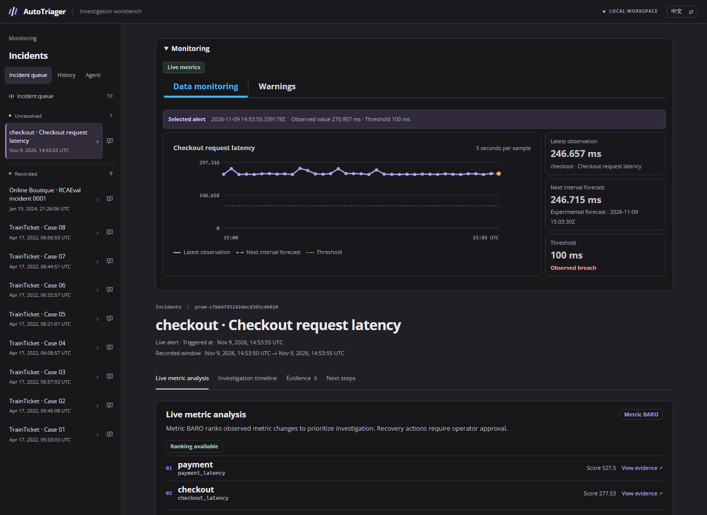

# AutoTriager

An incident investigation workbench for on-call engineers.

**Dahe Chen** · CS 5588 Data Science Capstone · University of Missouri–Kansas City

## Problem

A latency alarm identifies an affected service. The engineer still needs to find which dependency to investigate, inspect the underlying measurements, and verify that a recovery action worked.

## What the workbench does

Follow an alert from the live monitoring chart into its incident. The incident brings together candidate services, a dependency view, an investigation timeline, and clickable request evidence. An operator can approve a reset in the local lab. The workbench verifies recovery with fresh requests before resolving the incident.



## Implementation

| Layer | Technology and role |
| --- | --- |
| Workbench | React, TypeScript, and Cloudscape render monitoring, incident state, topology, and evidence. |
| Telemetry | Prometheus scrapes the checkout probe and evaluates the latency alert. The probe records timestamped checkout and downstream payment timings for investigation. |
| Candidate ranking | Metric BARO from a pinned RCAEval revision compares the reference and incident windows. Each ranked service links to its observed samples. |
| Incident state | A Python HTTP API and SQLite store alerts, evidence, and operator decisions. In the lab, recovery requires three new successful checkout requests at or below the latency threshold. |

## Get started

```powershell
git clone https://github.com/chendahe666/AutoTriager.git
Set-Location .\AutoTriager\workbench
```

Use the [Windows setup and demo guide](workbench/README.md) to install the Python and Node dependencies, check out the pinned RCAEval revision, configure local Prometheus, and run the controlled checkout incident. The guide includes verification and shutdown instructions. The live lab needs no model API key.

## Recorded comparison

All rows use the same 90 RCAEval RE2 Online Boutique development cases, known fault onset, and service-level scoring. The methods use different inputs and compute. B1 uses saved Gemini predictions from the fixed-evidence workflow. These results measure offline localization. The live recovery demonstration uses a separate controlled testbed.

| Method | Top 1 | Top 3 |
| --- | ---: | ---: |
| Metric BARO | 13/90 | 79/90 |
| Multi-source BARO | 15/90 | 79/90 |
| B1 (fixed evidence + Gemini) | 85/90 | 90/90 |

[Recorded results](workbench/verification/re2ob-multisource-baro-20261108/receipt.json) · [RCAEval benchmark and method source](https://github.com/phamquiluan/RCAEval) · [Third-party notices](workbench/THIRD_PARTY_NOTICES.md)
